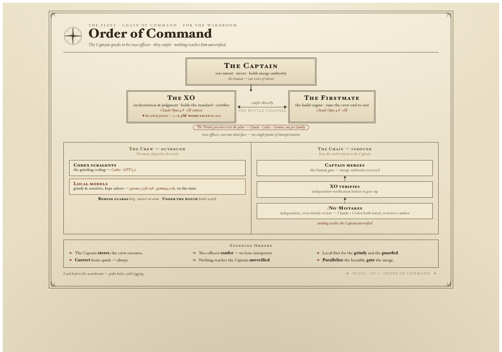
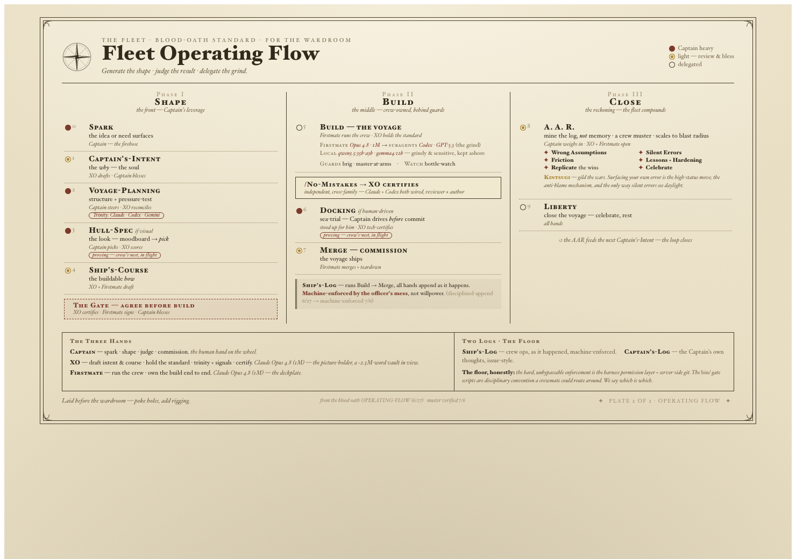

# fleet-doctrine

An operating philosophy — and the working pieces — for running autonomous build-agents: a human steers, agents execute, held together by **transparency and lightweight sign-off rather than heavy enforcement.**

Shared from a real setup. The naval framing is just a memorable handle for *who decides what.*

## The maps

Two engraved plates of the same system — one landscape frame each, made to be screenshotted and poked at.

**Order of Command** — the *who*. The human speaks to two officers (a planner and an executor) who confer directly; the executor dispatches the crew and cheap local models; everything returns through independent, cross-family review before it reaches the human.

**Operating Flow** — the *when*. One voyage from spark to close, each stage marked by how much the human's hand is on it (heavy / light / delegated). Two stages carry honest *"proving — in flight"* tags: they're being tested in a live voyage right now, not claimed as locked. The floor note says plainly which controls are enforced and which are convention.

*Source HTML for both lives in [`diagrams/`](./diagrams) — self-contained, adapt freely. The models and maturity tags reflect a real setup as of mid-2026.*

## What's here
- **[PHILOSOPHY.md](./PHILOSOPHY.md)** — the whole system and how we think about it: roles, altitude, the channel, authority, containment, the control philosophy, and the honest story of how it got built (and what's not built yet).
- **[CAPTAINS-INTENT.template.md](./CAPTAINS-INTENT.template.md)** — the WHY doc: north star, 5 whys, end state, limits.
- **[SHIPS-COURSE.template.md](./SHIPS-COURSE.template.md)** — the HOW doc: plan + opinions + an explicit **Latitude** section (free vs. fixed).
- **[YEOMAN.template.md](./YEOMAN.template.md)** — the correspondence channel format: append-only, newest-on-top, with the SAFE-PREPEND rule.
- **[blood-oath.md](./blood-oath.md)** — the commissioning standard: paired, signed orders before any build (and why we deferred the enforcement gate).

## Quick start
1. Copy the templates into your project.
2. Fill every `{{FILL: …}}` sentinel — zero left = ready to sign.
3. Human + planning agent draft; the executor reviews + revises the course; everyone signs.
4. Human's blessing on the course = launch.

## The load-bearing ideas (if you read nothing else)
- **Separate why from how** — intent steers, course executes; a task list in the intent doc is the tell you've drifted.
- **Make latitude explicit** — state where the agent is free vs. where deviating needs your word.
- **Prefer transparency to enforcement** — full candor + an open channel catches more than a wall, and can't wedge.
- **Be honest about mechanism vs. discipline** — know which of your rules are actually enforced and which are just convention.

Full reasoning in [PHILOSOPHY.md](./PHILOSOPHY.md). Adapt freely.
